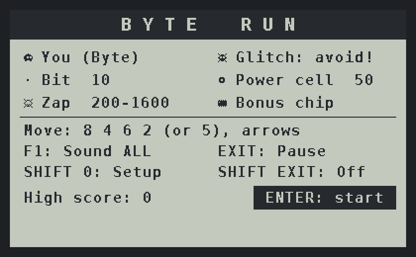
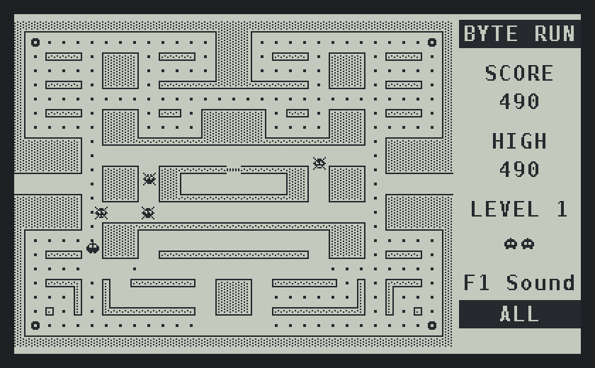

<h1 align="center">BYTE RUN</h1>

  <b>An original maze-chase game for the SwissMicros DM42 calculator</b> 
  
  
  
  

An original maze-chase game for the [SwissMicros DM42](https://www.swissmicros.com/product/dm42), written in C with the DMCP SDK.

You are Byte the robot. Collect all the bits, avoid the four Glitches, grab a power cell to zap them, and pick up bonus chips.

## Features

- Smooth 25 fps play with incremental screen updates
- Four enemies, each with its own way of hunting you; scatter and chase phases
- Grey-dithered maze walls, a tunnel, a bonus chip, and an extra life every 10,000 points
- Sound with glides and vibrato, an original start-up tune and background loops
- **F1** switches sound between ALL, FX (effects only) and OFF
- High score and sound setting are saved to `/BYTERUN.CFG`

Works with DMCP 3.14 and newer. It has been tested on DMCP 3.16.

## Install

1. Download `ByteRun.pgm` from the [Releases](../../releases) page (or build it yourself).
2. On the DM42, press SHIFT SETUP (the 0 key), choose System, then Activate USB Disk, and connect the USB cable.
3. Copy `ByteRun.pgm` to the root of the calculator's disk, then eject the disk.
4. Press SHIFT SETUP, choose System, then Load Program, and pick `ByteRun.pgm`.

Loading BYTE RUN replaces the DM42 calculator program.
**Keep a copy of the DM42 firmware (`DM42-x.y.pgm`, available from SwissMicros) on the calculator's disk**, then load it the same way to go back.
BYTE RUN has no QSPI data, so the DM42's QSPI contents are left untouched.

## Screenshot

## Keys

| Key            | Action                                      |
|----------------|---------------------------------------------|
| 8 / 4 / 6 / 2  | Up / left / right / down (5 also moves down) |
| ▲ / ▼          | Up / down                                   |
| ENTER          | Start                                       |
| F1             | Sound: ALL → FX → OFF                       |
| EXIT           | Pause / resume                              |
| SHIFT 0        | Setup menu (load programs, etc.)            |
| SHIFT EXIT     | Power off (the game pauses)                 |

## Scoring

Bit 10, power cell 50, Glitches 200, 400, 800 or 1600 in a row, bonus chip 100 to 5000 depending on the level.

## Building

You need the GNU Arm toolchain (`arm-none-eabi-gcc`), `make` and `crc32`. On Debian or Ubuntu:

    sudo apt install gcc-arm-none-eabi libnewlib-arm-none-eabi make libarchive-zip-perl
    make            # creates build/ByteRun.pgm

### Desktop simulator

`sim/` contains a test harness that runs the game core on a PC with an autopilot player and writes screenshots as PGM files:

    cd sim
    gcc -DSIM -O2 -o sim sim.c ../src/game.c
    ./sim

## Source layout

- `src/game.c`: the game itself (portable C, no DMCP calls)
- `src/plat.h`: the small platform interface the game uses
- `src/dm42_main.c`: DMCP glue (keys, LCD, buzzer, files, power handling)
- `src/menu.c`: setup menu (from the SDK)
- `dmcp/`, `bin/`, `stm32_program.ld`: DMCP SDK files

## Contributing

Bug reports, photos from real calculators and pull requests are welcome.
If you change the game logic, run the simulator first: it plays thousands of ticks with an autopilot and catches crashes quickly (build it with `-fsanitize=address,undefined` for extra checks).

## License

The BYTE RUN game code is released under the [MIT License](LICENSE).

The DMCP SDK files (`dmcp/`, `bin/`, `stm32_program.ld`, `src/menu.c`, `src/menu.h`, `src/qspi_crc.h`, `Makefile`) are © SwissMicros GmbH and distributed under the [BSD 3-Clause License](LICENSE-SDK).

BYTE RUN is an independent hobby project. It is not affiliated with or endorsed by SwissMicros.
